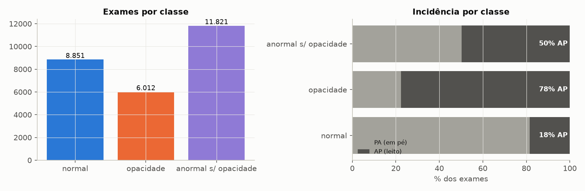
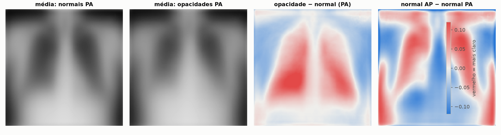
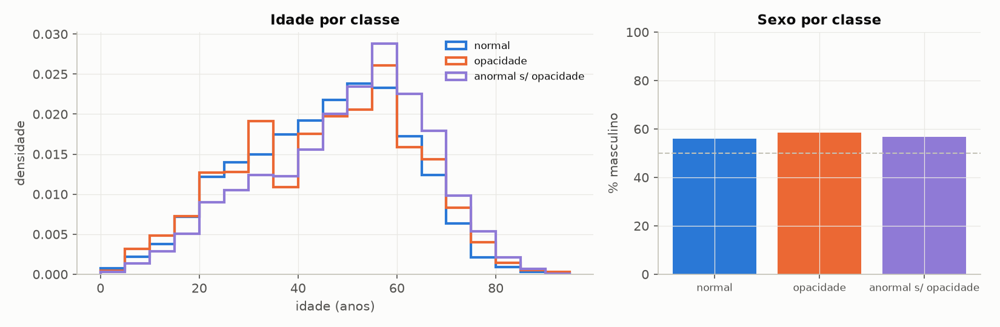
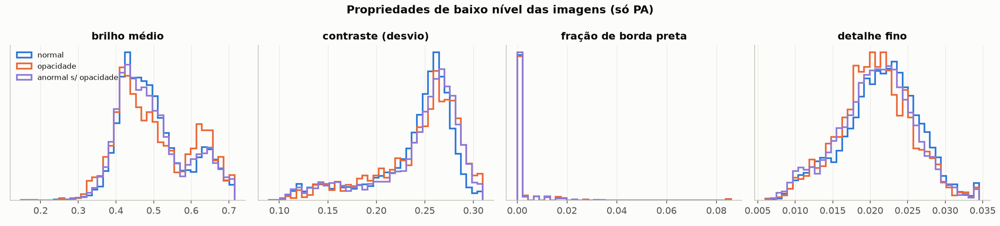
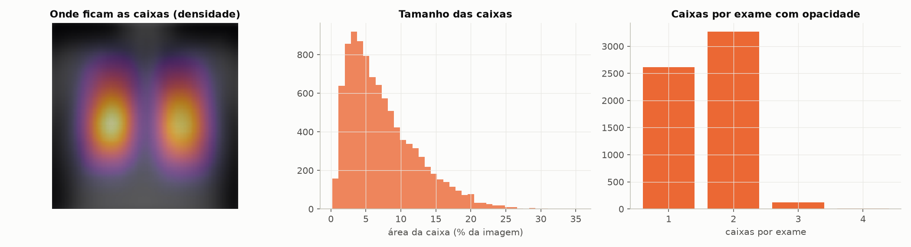

# EDA — RSNA Pneumonia Detection Challenge

Análise exploratória do dataset usado no pipeline, no mesmo formato do EDA do Olist: primeiro a **qualidade dos dados**, depois **perguntas orientadas por hipóteses**, cada uma com conclusão e implicação para a modelagem. No fim, uma tabela com **o que precisa (ou poderia precisar) de tratamento**.

Fontes: `stage_2_train_labels.csv`, `stage_2_detailed_class_info.csv`, os cabeçalhos dos 26.684 DICOMs e as imagens redimensionadas para 128 px (`data/processed/rsna_128.npz`). As figuras mostram só **agregados** (histogramas, imagens médias, densidade das caixas), nenhum exame individual.

## Desafio

Treinar um VAE **só com raios-X normais** para priorizar a fila de laudos. Isso coloca exigências específicas sobre os dados:

- o grupo "normal" precisa ser **representativo e homogêneo**: tudo o que varia entre normais e não foi aprendido vira falso alarme;
- **qualquer diferença sistemática entre as classes que não seja a doença** (incidência, equipamento, idade) pode virar um atalho;
- os rótulos e as caixas precisam ser **consistentes**, porque são eles que avaliam o modelo.

## Roteiro

1. Instante da previsão e vazamento de informação.
2. Qualidade dos dados, por dimensão.
3. Unidade de análise e classes.
4. Sete perguntas orientadas por hipóteses.
5. Tabela de tratamentos e implicações para a modelagem.

---

## 1. Instante da previsão e vazamento de informação

O modelo atua **quando o exame chega na fila**, antes do laudo.

| Disponível na chegada do exame | Informação futura — nunca usar como entrada |
|---|---|
| a imagem | a classe (normal, opacidade, anormal sem opacidade) |
| metadados do DICOM: idade, sexo, incidência (AP/PA), equipamento | as caixas das lesões |

Os metadados **não são vazamento** (estão disponíveis na chegada), mas são **fatores de confusão**: se estiverem associados à classe, o modelo pode usá-los como atalho mesmo sem recebê-los explicitamente, porque eles deixam marcas na imagem.

**Vazamento entre conjuntos:** há um exame por paciente, então separar exames é separar pacientes. A única exceção encontrada é um exame duplicado com dois IDs (seção 2).

---

## 2. Qualidade dos dados

| Dimensão | Checagem | Resultado |
|---|---|---|
| **Completude** | valores ausentes nos rótulos | `x`, `y`, `width` e `height` faltam em 20.672 linhas: **exatamente** os exames sem opacidade. Ausência estrutural, não erro. Cabeçalhos DICOM completos. |
| **Unicidade** | uma linha por exame? | Os rótulos têm 30.227 linhas para 26.684 pacientes (uma linha por caixa). O `detailed_class_info` tem **3.543 linhas duplicadas exatas**. |
| | imagens repetidas | **1 par de imagens idênticas** com IDs diferentes (mesma idade, sexo, incidência AP e classe "anormal sem opacidade"): é o mesmo exame cadastrado duas vezes. |
| **Consistência** | rótulo × classe × caixas | `Target = 1` ⟺ "Lung Opacity" em 100% das linhas; nenhuma caixa em exame negativo; nenhuma opacidade sem caixa; nenhuma caixa fora da imagem; uma única classe por paciente. |
| **Validade** | idade | Varia de 1 a **155 anos**: **5 exames com 148 a 155 anos** (impossível). **1.276 exames (4,8%) são de menores de 18 anos**, num dataset descrito como de adultos. |
| **Formato** | padronização das imagens | Todos: modalidade CR, parte do corpo CHEST, 1024 × 1024 px, 8 bits, MONOCHROME2, JPEG. Nada a padronizar. |
| | escala física (`PixelSpacing`) | 7 valores distintos (0,115 a 0,199 mm). Mas 1024 × 0,143 mm ≈ 15 cm, menor que um tórax: o valor foi herdado da imagem original, antes da redução para 1024 px. **Não serve como escala**, mas identifica o **equipamento** (pergunta 5). |

**Conclusão:** os rótulos são consistentes e completos. Os problemas reais são pontuais (duplicatas, idades inválidas) ou de **composição** (crianças, equipamentos, incidências), e esses últimos importam mais para um detector de anomalias.

---

## 3. Unidade de análise e classes

Um exame por paciente: 26.684 exames.

| Classe | Exames | % | Papel no pipeline |
|---|---|---|---|
| Normal | 8.851 | 33,2% | **treino do VAE** (só os de treino) e negativos da avaliação |
| Opacidade pulmonar | 6.012 | 22,5% | positivos da avaliação; 9.555 caixas |
| Anormal sem opacidade | 11.821 | 44,3% | teste à parte: "anomalias que o modelo nunca viu" |

---

## Pergunta 1: as classes estão balanceadas?

**Hipótese:** a classe positiva (opacidade) é minoritária, o que torna a acurácia enganosa.

**Resultado:** no conjunto completo, 22,5% de opacidades. No experimento principal (só PA), a proporção cai para **15,8%** no teste (203 de 1.285), porque a maioria das opacidades é AP (pergunta 2).

**Conclusão:** hipótese apoiada. Um "modelo" que responde "normal" para todos teria 84% de acurácia no teste PA.

**Implicação:** avaliar com AUC, AP (cujo valor do acaso é 0,158, não 0,5) e métricas do topo da fila, nunca com acurácia sozinha.

---

## Pergunta 2: a incidência (AP/PA) está associada à classe?

**Hipótese:** exames AP são feitos no leito, em pacientes internados e mais graves, então aparecem mais nas classes alteradas.

**Resultado:**

| Classe | % em AP |
|---|---|
| Normal | 18,5% |
| Anormal sem opacidade | 49,7% |
| Opacidade | **77,6%** |

A incidência muda a imagem por si só. A diferença entre a imagem média dos normais AP e dos normais PA é **maior** que a diferença entre opacidade e normal (figura abaixo, à direita). Propriedades simples também separam AP de PA entre os normais: contraste (AUC 0,74) e detalhe fino (AUC 0,70).

**Conclusão:** hipótese fortemente apoiada. "AP" é quase um sinônimo de "alterado" neste dataset.

**Implicação:** o experimento principal usa **só PA**, e o experimento com AP + PA serve para medir o atalho. O pipeline confirmou: com as duas incidências, o score separa AP de PA entre os normais (AUC 0,70) e a localização das lesões cai ao nível do acaso.

---

## Pergunta 3: idade e sexo variam entre as classes?

**Hipótese:** pacientes com alterações são mais velhos e podem ter outra distribuição de sexo.

**Resultado:**

- **Sexo:** 56–58% masculino em todas as classes. Sem diferença relevante.
- **Idade (mediana):** normal 46, opacidade 47, anormal sem opacidade **52**. As opacidades têm uma concentração extra entre 30 e 35 anos.
- 4,8% dos exames são de menores de 18 anos, distribuídos em todas as classes.

**Conclusão:** hipótese apoiada só em parte: os "anormais sem opacidade" são mais velhos. Opacidade e normal têm idades parecidas.

**Implicação:** a idade não é um atalho forte para a tarefa principal, mas pode ajudar a explicar parte do sinal nos "anormais sem opacidade" (anatomia mais velha também foge do "normal" aprendido). As crianças têm anatomia diferente e tendem a virar falsos positivos.

---

## Pergunta 4: as imagens diferem em propriedades simples?

**Hipótese:** em datasets de raio-X, diferenças de aquisição às vezes fazem propriedades simples da imagem (brilho, contraste, quantidade de detalhe fino) separarem as classes sem modelo nenhum. Algo parecido pode existir aqui.

**Resultado (só PA, AUC sem direção, 0,5 = sem separação):**

| Propriedade | opacidade × normal | anormal s/ opacidade × normal |
|---|---|---|
| Brilho médio | 0,51 | 0,51 |
| Contraste | 0,55 | 0,56 |
| Fração de borda preta | 0,51 | 0,51 |
| Detalhe fino | 0,55 | 0,54 |
| Pixels saturados (brancos) | 0,50 | 0,50 |

**Conclusão:** hipótese rejeitada. Dentro do PA, nenhuma propriedade simples separa as classes. É uma boa notícia: o VAE precisa achar o sinal na **anatomia**, e não em artefatos.

**Implicação:** a heurística de nível de detalhe usada como referência no pipeline fica em 0,55: não é um atalho aqui. Mas o **brilho tem dois picos** (por volta de 0,43 e 0,63), o que leva à próxima pergunta.

---

## Pergunta 5: existe um "equipamento" escondido nos dados?

**Hipótese:** os dois picos de brilho correspondem a grupos de aquisição diferentes (equipamentos ou protocolos de processamento).

**Resultado:** o `PixelSpacing`, que não serve como escala (seção 2), funciona como impressão digital do equipamento, e está ligado ao brilho **e** à incidência:

| `PixelSpacing` | Exames | % no grupo "claro" (brilho > 0,55) | % PA |
|---|---|---|---|
| 0,143 | 8.993 | 3,9% | 100% |
| 0,194 | 1.358 | 0,1% | 99,7% |
| 0,139 | 5.511 | 11,0% | 19,8% |
| 0,168 | 8.815 | 44,2% | 24,5% |
| 0,171 | 1.996 | 53,6% | 45,7% |

Dentro do PA, os equipamentos "claros" (0,168 e 0,171) respondem por **29,4% das opacidades**, contra **19,5% dos normais**. O grupo claro sozinho separa opacidade de normal com AUC 0,54.

**Conclusão:** hipótese apoiada. Equipamento, brilho e incidência formam um bloco de fatores de aquisição entrelaçados. Restringir a PA remove a maior parte do efeito, mas sobra um **viés leve de equipamento**.

**Implicação:** testar uma **normalização de intensidade por imagem** (equalização de histograma ou padronização) e reportar a AUC por grupo de equipamento. Em produção, o "normal" teria que ser recalibrado por equipamento.

---

## Pergunta 6: como são as lesões?

**Hipótese:** as opacidades são regiões médias, nos campos pulmonares inferiores, muitas vezes nos dois pulmões.

**Resultado:**

- **Caixas por exame:** 1 caixa em 2.614 exames, 2 em 3.266, 3 em 119 e 4 em 13. **56,5% dos exames têm mais de uma caixa** (geralmente uma em cada pulmão).
- **Tamanho:** cada caixa cobre em mediana **6,2%** da imagem (média 7,4%; de 0,2% a 35%). Somando as caixas de cada exame, mediana de **8,7%**.
- **Largura em 128 px:** mediana de **27 px**.
- **Posição:** os dois pulmões, com mais caixas na metade inferior (56,7%). 53,5% ficam do lado esquerdo da imagem, que é o pulmão **direito** do paciente.
- **Lesões em AP são maiores** que em PA (mediana de 6,8% contra 4,1% da imagem por caixa).

**Conclusão:** hipótese apoiada.

**Implicações:**

- **O σ escolhido pelo pipeline bate com o tamanho das lesões:** uma gaussiana com σ = 10 px tem largura a meia altura de ~24 px, perto dos 27 px típicos de uma caixa. A suavização "enxerga" na escala das opacidades.
- As lesões do PA são menores, então **o experimento só PA é mais difícil**. Parte do ganho do experimento AP + PA vem de lesões maiores, e não só do atalho.
- A referência do acaso para a localização é a fração da imagem coberta pelas caixas (~7% no teste PA).
- Para avaliar, as caixas de um mesmo exame são unidas numa única máscara.

---

## Pergunta 7: o "normal" é homogêneo?

**Hipótese:** mesmo entre os normais há variações de aquisição que o VAE vai tratar como anomalia.

**Resultado:**

- **Bordas pretas** (imagem menor dentro de uma moldura): 2,6% dos normais PA têm mais de 2% de linhas ou colunas pretas, e 0,5% têm mais de 10%. Na demo, o 1º da fila é um normal com moldura preta.
- **Dois grupos de brilho:** 24% dos normais PA estão no grupo "claro" (pergunta 5). O VAE precisa aprender dois "normais".
- **Marcadores e textos** (letras L/R, setas, anotações) aparecem nos cantos de muitas imagens. Os mapas de calor acendem nesses cantos.
- **Crianças:** 4,8% dos exames, com proporções corporais diferentes.

**Conclusão:** hipótese apoiada. Boa parte dos falsos positivos vem dessas variações, e não de doença.

**Implicação:** recortar automaticamente as bordas, normalizar a intensidade e, principalmente, **restringir o score aos campos pulmonares** com uma máscara de segmentação.

---

## Checagem dos conjuntos

O split é feito por paciente (70/15/15), estratificado por classe e incidência, **antes** do filtro de incidência. Assim, o teste só PA é um pedaço do teste AP + PA.

| | Só PA | AP + PA |
|---|---|---|
| Treino do VAE (normais) | 5.050 | 6.196 |
| Opacidades no treino (só para a CNN) | 943 | 4.208 |
| Validação (opacidades) | 1.284 (202) | 2.229 (902) |
| Teste (opacidades) | 1.285 (203) | 2.230 (902) |
| Anormais sem opacidade no teste | 892 | 1.773 |

---

## Dados que precisam (ou poderiam precisar) de tratamento

✅ = já tratado no pipeline · 💡 = proposta

| # | Problema | Evidência | Impacto | Tratamento |
|---|---|---|---|---|
| 1 | Linhas duplicadas no `detailed_class_info` | 3.543 linhas | contagem de classes inflada | ✅ deduplicação por paciente |
| 2 | Exame cadastrado com dois IDs | 1 par idêntico | vazamento se cair em conjuntos diferentes | 💡 remover a duplicata (não afeta o experimento só PA) |
| 3 | Idades impossíveis | 5 exames, 148–155 anos | só análises por idade | 💡 tratar como ausente (o modelo não usa idade) |
| 4 | Crianças num dataset de adultos | 1.276 exames (4,8%) | falsos positivos por anatomia diferente | 💡 analisar à parte ou remover do treino |
| 5 | Incidência associada à classe | 18% × 78% AP | **atalho forte** | ✅ só PA; ✅ avaliação por incidência |
| 6 | Equipamento associado a brilho e classe | 29% × 20% em equipamentos "claros" | atalho leve | 💡 normalização de intensidade; AUC por equipamento |
| 7 | Bordas pretas e enquadramento atípico | 2,6% dos normais PA | falsos positivos | 💡 recorte das bordas |
| 8 | Marcadores e textos nos cantos | visível nos mapas de calor | falsos positivos | 💡 máscara dos pulmões no score |
| 9 | `PixelSpacing` não confiável como escala | 1024 × 0,143 mm ≈ 15 cm | medir lesões em mm daria errado | ✅ não usado como escala |
| 10 | Caixas ausentes nos negativos | 20.672 linhas | nenhum (é esperado) | ✅ não imputar |
| 11 | Classes desbalanceadas | 15,8% de opacidades no teste PA | acurácia enganosa | ✅ AUC, AP e métricas do topo da fila |
| 12 | Redução de 1024 para 128 px | lesões com ~27 px de largura em 128 px | lesões muito pequenas se perdem | ✅ 128 px como compromisso; 💡 testar 256 px |

> ⚠️ 18/10/2026: o que aconteceu com cada proposta (💡):
>
> - **2, 3 e 4:** tratados na v2. A duplicata saiu, as idades impossíveis viraram ausentes, e os menores de 18 ficaram fora do escopo. Ver [07-higiene-v2.md](07-higiene-v2.md).
> - **6:** a AUC por equipamento entrou na v2; a normalização de intensidade (ablação B) foi **aceita** e está na v3. O viés de equipamento diminuiu, mas não sumiu.
> - **7:** o recorte das bordas (ablação A) foi **rejeitado**: não melhorou a AUC.
> - **8:** a máscara dos pulmões (ablação C1) foi **aceita** e está na v3, como máscara média. A segmentação por exame ficou como trabalho futuro. Ver [08-ablacoes.md](08-ablacoes.md).
> - **12:** 256 px não foi testado.

## Conclusões para a modelagem

1. **Os rótulos são confiáveis** (consistentes e completos); os problemas estão na **composição** do dataset.
2. **A incidência é o maior risco**: daí o experimento principal só com PA.
3. **Dentro do PA não há atalho simples** de brilho, contraste ou detalhe. O sinal precisa vir da anatomia.
4. **Sobra um viés leve de equipamento**, que vale testar com normalização de intensidade.
5. **O tamanho das lesões justifica o σ** escolhido e a resolução de 128 px.
6. **O "normal" não é homogêneo** (bordas, marcadores, crianças, dois grupos de brilho): a principal melhoria futura é restringir o score aos pulmões.
