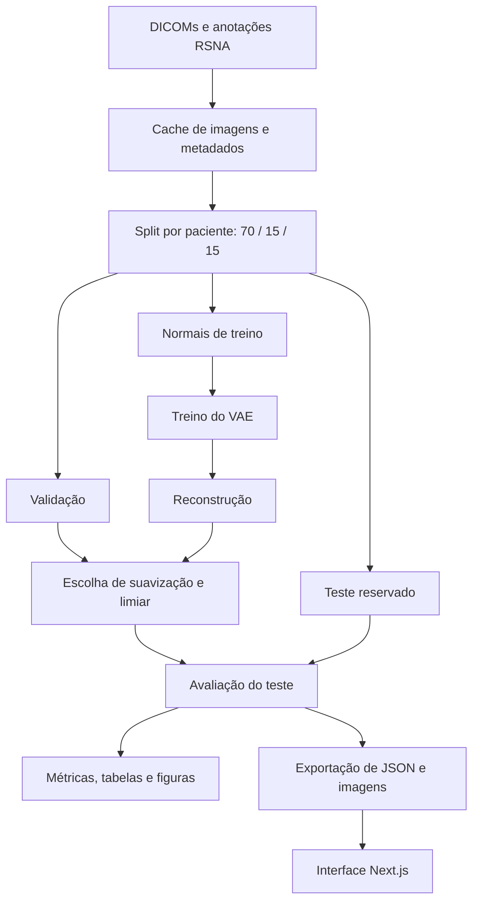

# Guia do projeto: finalidade, funcionamento e interface

Este guia descreve o código e os resultados versionados no repositório. Os números abaixo são da execução **`rsna_pa_v2`, semente 0**, salvo quando outra execução for indicada. Resultados antigos em `rsna_pa` e `rsna_ap_pa` pertencem à v1.

> Atualização de 18/10/2026: a demo agora usa a **v3**, com normalização por imagem e máscara pulmonar média. Os números da seção 7 permanecem como referência histórica da v2. Veja os [resultados finais da v3](09-resultados-v3.md) e a seção **Modelos e métricas** (`/#models`) para comparar as versões. Na v3, a imagem apresentada como original já é normalizada; o mapa é `M ⊙ [Gσ ∗ (x − x̂)]²`, e o score continua sendo a média na imagem inteira, com zeros fora da máscara.

## 1. Qual pergunta o projeto tenta responder?

Um modelo treinado apenas com radiografias normais consegue reconhecer exames diferentes do padrão e colocá-los mais cedo numa fila de revisão?

O objetivo é testar **detecção de anomalias para priorização de exames de tórax**. Há três perguntas experimentais: o score separa normal de opacidade? O mapa de calor coincide com as regiões anotadas? A ordenação antecipa exames com opacidade?

O rótulo positivo do experimento é **opacidade pulmonar no dataset**, que não confirma, sozinho, um diagnóstico de pneumonia. O modelo também não estima gravidade ou urgência clínica: a prioridade da demo significa apenas posição pelo score de anomalia.

## 2. As duas partes do sistema

| Parte | Tecnologia | Responsabilidade |
|---|---|---|
| Experimento | Python, PyTorch, NumPy, pandas, scikit-learn | Preparar dados, treinar, calibrar, avaliar e exportar resultados |
| Interface | Next.js, React, TypeScript e CSS | Explorar os resultados exportados e simular a ordenação |
| Rastreamento | MLflow local | Registrar parâmetros, métricas e artefatos das execuções |



A interface **não tem uma API de inferência**. Ao selecionar um exame, não envia sua imagem ao Python: troca os arquivos exibidos e consulta valores já calculados. A ordenação e o jogo acontecem no navegador.

## 3. De onde vêm os dados?

O pipeline usa o RSNA Pneumonia Detection Challenge, com 26.684 radiografias e três classes: normal, opacidade e anormal sem opacidade. As imagens de origem são DICOMs de 1024 × 1024. O notebook inicial usa outro conjunto, PneumoniaMNIST, e resolução de 64 × 64; ele é uma versão didática anterior.

Em `module_vae/dataset.py`, o código lê os DICOMs, uniformiza a orientação de intensidade quando necessário e redimensiona os pixels para **128 × 128**. Também lê idade, sexo, incidência AP/PA e PixelSpacing. Os dados ficam em cache em `data/processed`, evitando reler todos os DICOMs a cada execução.

A v2 exclui duplicatas de pixels, pacientes menores de 18 anos e idades ausentes ou fora da faixa aceita pelo código. PixelSpacing é usado para investigar diferenças entre equipamentos; não é interpretado como escala física confiável da imagem redimensionada.

`module_vae/modeling/split.py` separa 70% para treino, 15% para validação e 15% para teste, com semente 42 e estratificação por classe e incidência. Há um exame por paciente no conjunto usado. Os filtros de incidência e de escopo são aplicados depois do sorteio, para manter comparabilidade entre versões. O teste fica reservado para avaliação.

Somente os normais do treino alimentam o VAE. A classe anormal sem opacidade do teste é avaliada separadamente, como exemplo de alterações que não fizeram parte da escolha de parâmetros.

## 4. O que é o VAE neste código?

Um autoencoder tenta reconstruir sua entrada passando por uma representação compacta. A versão variacional aprende uma distribuição para essa representação.

1. O **encoder** reduz uma imagem de 128 × 128 por convoluções até um tensor de 256 × 4 × 4.
2. Duas camadas produzem **μ** e **log σ²**, cada uma com oito valores. Eles representam a média e a variância de uma distribuição no espaço latente.
3. Durante o treino, o modelo amostra um código: `z = μ + exp(0,5 × log σ²) × ε`, com `ε` normal padrão.
4. O **decoder** transforma os oito números numa reconstrução de 128 × 128, com pixels em `[0, 1]`.

A loss é `BCE de reconstrução + β × KL`. A BCE penaliza diferenças entre a imagem e a reconstrução; a KL regulariza o espaço latente em direção à normal padrão. O peso da KL cresce ao longo das primeiras dez épocas, até β = 1. O padrão é treinar 40 épocas, com Adam, taxa de aprendizado 0,001 e lotes de 64.

Durante a avaliação, o código usa **z = μ**, sem amostragem. Assim, a reconstrução do mesmo exame é determinística.

A hipótese é que, por ter aprendido apenas com normais, a rede reproduza pior algumas alterações. Isso é uma hipótese a medir: o decoder pode apagar características normais, reproduzir parte de uma alteração ou responder a diferenças de aquisição. A reconstrução é a saída do modelo, não uma versão comprovadamente saudável do paciente.

## 5. Como surgem o score e o mapa de calor?

`module_vae/features.py` calcula:

```text
resíduo       = imagem original − reconstrução
mapa de calor = filtro_gaussiano(resíduo, σ)²
score         = média de todos os pixels do mapa
```

A ordem das operações importa: **primeiro suaviza o resíduo; depois eleva ao quadrado**. Isso reduz a influência de detalhes finos que o VAE reconstrói mal, como bordas e costelas, e preserva diferenças em regiões maiores. Com σ = 0, o score vira o erro quadrático médio comum.

A suavização é escolhida pela melhor AUC na validação, usando normais e positivos. Portanto, embora o treino do VAE use somente normais, a seleção de σ usa rótulos de opacidade da validação. Na execução PA v2, σ = 8 pixels.

O limiar principal é o **percentil 95 dos scores dos normais da validação**: `0,00364366`. Isso admite aproximadamente 5% de falsos alertas nesses normais de validação; a taxa no teste pode ser diferente.

Para facilitar a leitura, a interface exibe **score × 1.000**: o limiar bruto `0,00364366` aparece como `3,64`. É apenas uma mudança de escala de apresentação, sem alterar decisões ou ordenação.

O score não é porcentagem ou probabilidade de pneumonia. O percentil mostrado no visualizador compara o score com os normais da validação: “mais anômalo que 98% dos normais” não significa “98% de chance de doença”.

Um normal pode ficar antes de uma opacidade porque o ranking usa o erro médio de reconstrução, sem consultar o rótulo. A reconstrução pode errar anatomia ou características de aquisição de um normal; uma opacidade pode ter pouca influência na média do mapa ou ser parcialmente reconstruída. Esses mecanismos são possibilidades, não uma explicação confirmada de cada exame. Mudar somente o limiar muda os alertas, mas mantém a ordem. Ao revelar os laudos, a interface identifica as discordâncias e explica um par real quando há esse tipo de inversão.

## 6. Por que existem modelos PA e AP + PA?

No RSNA, incidência e classe têm forte associação. Os exames com opacidade são mais frequentemente AP que os normais. Misturar AP e PA pode permitir que o modelo use diferenças de aquisição como atalho.

O resultado principal usa apenas PA. O modelo AP + PA é uma execução separada para investigar esse efeito. Sua AUC geral é maior, mas cai quando cada incidência é avaliada isoladamente. Na interface, trocar o modelo também troca a amostra da fila, porque cada execução tem seu próprio conjunto elegível; não é uma comparação pareada dos mesmos vinte exames.

## 7. O que os resultados da v2 permitiam concluir?

| Medida | PA v2, semente 0 | Como interpretar |
|---|---:|---|
| Exames no teste principal | 1.226 | 1.035 normais e 191 com opacidade |
| AUC ROC | 0,7686 | Capacidade de ordenação entre opacidade e normal; não é acurácia |
| AUC sem suavização | 0,7003 | O score suavizado melhorou a ordenação nesta execução |
| Sensibilidade no limiar | 29,3% | Sinalizou 56 de 191 opacidades e deixou 135 abaixo do limiar |
| Especificidade no limiar | 94,9% | Deixou 982 de 1.035 normais abaixo do limiar; houve 53 falsos alertas |
| Precisão dos alertas | 51,4% | 56 dos 109 exames sinalizados tinham opacidade |
| Acurácia | 84,7% | Muito próxima de prever todos como normais: 84,4% |
| Opacidades entre os dez maiores scores do teste | 9 de 10 | Bom resultado no topo desta ordenação; cobre somente 9 das 191 opacidades |
| Pico do mapa dentro de alguma caixa | 13,6% | A localização ainda é fraca |

Nas simulações de filas de cem exames, a posição média dos positivos passou de aproximadamente **50,6 para 26,7**. Isso mede antecipação em posições de uma simulação, sem estimar minutos reais de espera ou impacto clínico. A interface mostra uma amostra de vinte exames, cujos indicadores são calculados naquela amostra e podem diferir dessas médias.

Na comparação entre métodos, a AUC média do VAE em três sementes foi 0,7651 ± 0,0088; o autoencoder comum teve 0,7551 ± 0,0052 e a PCA com oito componentes, 0,7478. A CNN supervisionada de referência teve 0,8754 e foi treinada com normais e positivos. Esses resultados não demonstram que o VAE seja necessário ou superior para qualquer cenário.

A evidência mais favorável está na **ordenação**, enquanto o limiar escolhido tem baixa sensibilidade e o mapa não oferece localização confiável. A aplicação continua sendo uma prova de conceito acadêmica.

## 8. Como a interface funciona?

`module_vae/export.py` carrega pesos e metadados, calcula reconstruções e scores e salva `interfaces/public/data/data.json` com imagens e sprites. Os originais apresentados têm 512 × 512; o modelo e seus mapas usam 128 × 128. O JSON usa códigos como `EX-0006`, sem guardar o patientId original.

`interfaces/app/page.tsx` lê os JSONs no build e entrega os dados aos componentes React. O Next.js pré-renderiza a página. As cinco áreas ficam montadas, preservando as escolhas ao navegar.

**Entenda o VAE:** é a entrada padrão. O percurso tem cinco etapas: problema, arquitetura, parte variacional, score e aplicação na fila. O diagrama mostra o encoder, as distribuições e o decoder; a fórmula de treino é explicada em linguagem técnica e comum. Uma distribuição de uma dimensão permite ajustar μ, σ e ε e observar `z = μ + σ × ε`. Esses valores são didáticos, não são códigos de um paciente e não executam o modelo. A etapa do score usa um exame real exportado, com suas imagens e limiar reais. A etapa final conecta esse exame às duas ordenações e aos limites de avaliação.

**Fila de triagem:** compara chegada e score decrescente. No ritmo padrão, a simulação adiciona um exame a cada 650 ms, com pausa, continuação e restauração. Busca e filtro de alertas mostram subconjuntos sem recalcular o modelo. O visualizador oferece original, reconstrução, comparação por divisor, calor com opacidade ajustável e caixas das anotações. As caixas só podem ser mostradas após revelar os laudos. “Padrão” significa score abaixo do limiar, sem garantir ausência de alteração.

As duas filas aparecem simultaneamente e destacam o mesmo exame. A posição é calculada entre os exames que já chegaram; selecionar na comparação limpa os filtros da lista de trabalho para tornar o exame acessível. A análise ampliada apresenta original, reconstrução e mapa juntos, com a fórmula do score e a leitura em relação ao limiar. O modo de imagem permite zoom de 100% a 300%, rolagem e alternância de imagem. O zoom não recupera detalhe além dos 512 px do original ou 128 px da reconstrução e mapa. No celular, a seleção abre esse diálogo automaticamente. O diálogo usa o comportamento modal nativo, fecha por Escape e restaura o foco; as setas navegam entre exames quando não estão controlando a imagem com zoom.

A simulação permite velocidades de 1,3 s, 0,65 s e 0,325 s por chegada; isso controla a apresentação, sem representar tempo clínico. É possível pausar, adicionar apenas o próximo exame e seguir automaticamente a última chegada. Uma linha conecta as posições acompanhadas nas duas listas. O modo apresentação aproxima comparação e visualizador. Na operação em desktop, lista de trabalho e visualizador compartilham a mesma altura; os exames rolam dentro da lista.

**Por dentro do VAE:** o gerador consulta nove imagens por eixo latente, entre −3 e +3. Só um eixo muda por vez; não há decoder executando no navegador. O mapa usa as duas primeiras componentes da PCA dos códigos μ. O controle de suavização e a interpolação também consultam resultados pré-calculados. A projeção 2D é uma visualização, não uma classificação.

**Você × VAE:** o usuário ordena oito exames, revela os rótulos e compara quantas opacidades aparecem no começo das filas. O estado fica no navegador durante a sessão; não há votação remota, conta ou placar compartilhado.

**Modelos e métricas:** a página separa PA de AP + PA e permite selecionar a versão. O gráfico e a tabela mostram a evolução; a AUC do modelo salvo fica separada da média ± desvio-padrão de múltiplos treinos. A comparação de métodos explicita quantos treinos foram feitos e quais métodos usam rótulos. As ablações mostram resultados de validação e a decisão registrada, sem usar o teste para escolher a configuração.

O seletor de limiar consulta `thresholds.csv`: não roda otimização e não altera o ranking da fila. As contagens da matriz de confusão são recuperadas a partir da sensibilidade, especificidade e dos totais reais do teste. A localização é apresentada como acerto menos acaso da configuração, pois restringir o mapa aos pulmões também aumenta a chance de acertar uma caixa sem informação útil.

Ao iniciar ou construir o front, `scripts/model-catalog.mjs` gera `public/data/models.json` diretamente de `models/*/metadata.json` e dos relatórios correspondentes. A página não depende de valores de AUC digitados no JSX. Os metadados da mesma execução completam campos descritivos ausentes em exports antigos; a interface não recalcula imagens nem scores. O catálogo completo pode ser baixado na própria página.

## 9. O que foi melhorado na interface?

- Navegação lateral, indicação da área atual e organização dos controles por tarefa.
- Busca por código, filtro de alertas e preservação da posição original dentro da ordenação filtrada.
- Estados vazios coerentes: nenhum exame futuro aparece antes de chegar na simulação.
- Pausa, continuação e restauração da simulação.
- Seleção por teclado, abas com setas/Home/End e endereços `#queue`, `#inside`, `#game` integrados ao histórico.
- Navegação anterior/próximo no visualizador e bloqueio das caixas enquanto os laudos estão ocultos.
- Layout adaptado a telas pequenas e respeito à preferência por menos movimento.
- Remoção do QR ilustrativo e da descrição de votação ao vivo; o jogo apresenta o progresso local real.
  > ⚠️ 21/10/2026: o QR voltou, agora funcional. Ele abre o site na aba `#game`, para a turma jogar o desafio no próprio celular. A votação ao vivo continua fora.
- Testes de navegador para os fluxos principais, em desktop e celular.
- Percurso técnico com ilustração da distribuição latente, diagrama do modelo e exemplo real de cálculo do score.
- Comparação simultânea das ordenações, com destaque e explicação da mudança de posição do exame selecionado.
- Análise lado a lado e imagem ampliada com zoom, navegação por teclado e diálogo dedicado no celular.

## 10. Como rodar e o que ainda depende de dados externos?

Para a interface, basta Node.js 20 ou superior. Não é necessário baixar o RSNA nem treinar:

```powershell
cd interfaces
npm.cmd ci
npm.cmd run dev
```

Abra `http://localhost:3000`. Para verificar a interface:

```powershell
npm.cmd run typecheck
npm.cmd run build
npm.cmd run test:ui
```

Os testes usam o Chrome instalado e iniciam temporariamente a versão de produção na porta 3187. O build deve ser executado antes dos testes de navegador.

Para o Python, o projeto exige **3.12** e trava as dependências em `uv.lock`. Com uv disponível: `uv sync --frozen` e `uv run python -m pytest tests -q`. Nesta preparação, o uv também foi instalado localmente em `.bootstrap/packages/bin/uv.exe`; essa pasta é ignorada pelo Git. O Python do projeto fica em `.venv`.

O checkout contém os resultados e os arquivos exportados da interface, mas os pesos `vae.pt` e o dataset não são versionados. Para treinar novamente ou regenerar a exportação, é preciso obter o RSNA com as credenciais e regras do Kaggle e ter pesos compatíveis, ou treiná-los. A instalação das dependências, sozinha, não gera esses artefatos.

## 11. Próximas melhorias, por prioridade

1. **Avaliação:** apresentar intervalos de confiança, estabilidade entre sementes e equipamentos e a relação entre sensibilidade e carga de alertas. O limiar atual perde muitas opacidades.
2. **Localização:** comparar mapas com as caixas de forma mais rigorosa e estudar o recorte dos pulmões. O calor atual pode responder a aquisição e anatomia.
3. **Reprodutibilidade:** documentar onde obter cada versão dos pesos e garantir que exportação, metadados e relatórios correspondam à mesma execução.
4. **Inferência interativa:** se a finalidade passar a incluir imagens novas, implementar uma API ou exportação para ONNX, com pré-processamento idêntico ao treino e estados de falha explícitos. Essa funcionalidade ainda não existe.
5. **Apresentação colaborativa:** votação em tempo real exige serviço de sessões e armazenamento, além de QR funcional. Não faz parte do jogo local atual.
   > ⚠️ 21/10/2026: o QR funcional já existe (abre `#game` no celular). Falta o serviço de sessões e armazenamento para juntar os votos.

Fontes primárias desta explicação: o código em `module_vae/`, os componentes em `interfaces/`, `models/rsna_pa_v2/metadata.json` e `reports/rsna_pa_v2/metrics.json`.

## 12. Como conferir uma nova execução?

Os números deste documento continuam sendo os resultados históricos de `rsna_pa_v2`, semente 0. Uma nova execução deve ser avaliada pelos próprios relatórios, sem reaproveitar automaticamente estas conclusões.

A fila mostra o nome da execução e a data de geração do JSON. Os valores de score, limiar, suavização e métricas são lidos da exportação. Nas novas exportações, resolução, épocas, versão e regra de limiar também vêm dos metadados, quando disponíveis. Se um campo não estiver presente, a interface informa essa ausência.

Antes de visualizar outra versão, rode `npm run validate:data` e `npm run test:data` em `interfaces/`, depois faça o build e os testes de navegador. A validação detecta inconsistências de formato, arquivos ausentes, alertas calculados com outro limiar e sprites que não correspondem à dimensão latente. Ainda é necessário revisar o desenho experimental e as métricas do novo modelo: essa validação confere o contrato dos arquivos, não a qualidade científica da execução.
