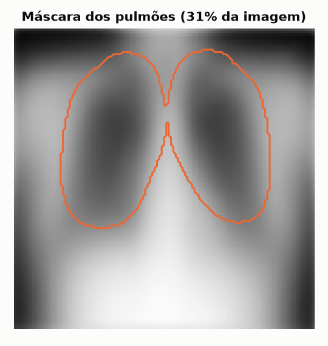
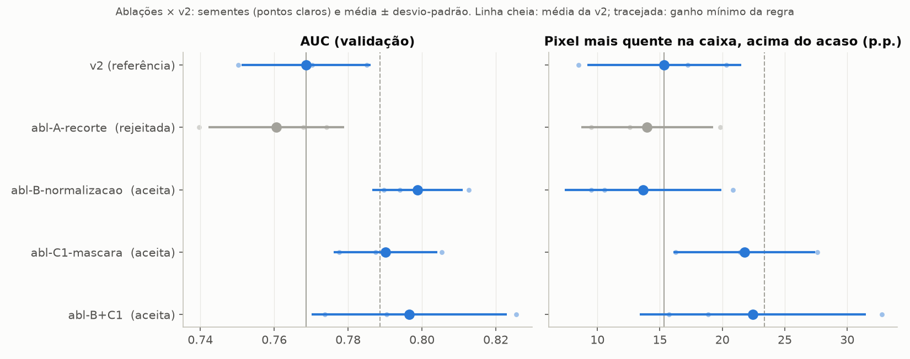

# Ablações: o que entra na v3 (18/10/2026)

Uma **ablação** muda uma única coisa no pipeline e compara o resultado com a versão sem a mudança. As três primeiras vêm direto do EDA ([06-eda-rsna.md](06-eda-rsna.md), pergunta 7 e tabela de tratamentos). Todas foram comparadas com a v2 ([07-higiene-v2.md](07-higiene-v2.md)), **só com a validação**: o teste ficou guardado para a configuração final.

| Ablação | O que muda | Por que testar |
|---|---|---|
| A, recorte das bordas | tira as molduras pretas (faixas pretas e uniformes nas bordas) e volta a 128 px | molduras viram falsos alarmes (2,6% dos normais PA com moldura > 2%) |
| B, normalização de intensidade | estica o brilho de cada imagem entre os percentis 1 e 99 dela (linear, não muda a ordem dos tons) | equipamento e brilho andam juntos; viés leve de equipamento |
| C1, máscara pulmonar média | score e mapa de calor só dentro de uma máscara dos pulmões | o mapa acende em ombros, cantos e marcadores |
| C2, segmentação de cada exame | uma máscara por exame, com um modelo pré-treinado | só se a C1 funcionasse |

## A regra, fixada antes de rodar

Escrita e aprovada **antes** de qualquer resultado de ablação, para ninguém escolher o critério depois de ver os números.

- Cada ablação roda com **3 sementes** (0, 1 e 2), 40 épocas, sem baselines, só PA.
- Compara-se a **média das sementes** com a média da v2 (AUC de validação 0,769 ± 0,018; localização 15,4 ± 6,2 pontos acima do acaso).
- **Aceita** se a AUC de validação subir pelo menos **0,02**, **ou** se a localização subir pelo menos **8 pontos percentuais**, desde que a outra métrica não piore mais que **um desvio-padrão** da v2.
- Ganhos menores que isso não são distinguíveis do ruído entre treinos com 3 sementes. Essa é uma limitação assumida: a regra só enxerga efeitos grandes.

**Por que 3 sementes:** o plano original era 1 semente e tolerância de 2 pontos na localização. A v2 mostrou que só trocar a semente muda a AUC de validação em 0,035 e a localização em 12 pontos ([07](07-higiene-v2.md)). Com uma semente, a decisão seria sorteio.

### Correção da regra (antes dos resultados)

A localização é medida **acima do acaso** de cada configuração: o acerto menos a fração da área do mapa coberta pelas caixas.

O "acaso" é o acerto de um mapa sem informação, como um dardo jogado de olhos vendados. Sem máscara, o dardo pode cair na imagem inteira, e acerta a caixa em **7,5%** das vezes. Com a máscara da C1, o mapa só existe nos pulmões, onde estão as caixas, e o dardo acerta em **17,6%**. Sem a correção, a C1 ganharia cerca de 10 pontos sem localizar nada melhor. Para A e B, nada muda.

A correção foi aprovada no mesmo dia, **antes de qualquer resultado de ablação**, e só deixa a regra mais rígida.

## A máscara dos pulmões (C1)

Definida uma vez, a partir da **imagem média dos normais de treino**, antes de qualquer resultado:

1. na imagem média, os pulmões são as duas regiões escuras no meio do tórax (o ar dos cantos também é escuro, mas toca a borda);
2. o limiar desce até os dois pulmões aparecerem separados da borda: esse "miolo" cobre só a parte mais escura;
3. a máscara cresce 10 px, a escala das lesões (largura típica de 27 px) e do σ, para incluir os campos inferiores e as bordas dos pulmões.



A máscara cobre 31% da imagem e exclui ombros, cantos, pescoço e abdômen. A figura é da v3: a imagem média de exames já normalizados (ablação B).

## Resultados (validação, média de 3 sementes)

| | AUC val | Δ AUC | Pixel mais quente na caixa | Acaso | Acima do acaso | Δ | Decisão |
|---|---|---|---|---|---|---|---|
| v2 (referência) | 0,769 ± 0,018 | — | 22,9% | 7,5% | 15,4 p.p. | — | — |
| **A**, recorte | 0,761 ± 0,018 | −0,008 | 21,5% | 7,5% | 14,0 p.p. | −1,4 | ❌ rejeitada |
| **B**, normalização | **0,799 ± 0,012** | **+0,030** | 21,1% | 7,5% | 13,6 p.p. | −1,7 | ✅ aceita (AUC) |
| **C1**, máscara | **0,790 ± 0,014** | **+0,022** | **39,5%** | 17,8% | 21,8 p.p. | +6,4 | ✅ aceita (AUC) |



Comparando semente com semente, B e C1 superam a v2 **nas 3 sementes**:

| Semente | v2 | A | B | C1 |
|---|---|---|---|---|
| 0 | 0,770 | 0,774 | 0,794 | 0,788 |
| 1 | 0,785 | 0,768 | 0,813 | 0,805 |
| 2 | 0,750 | 0,740 | 0,790 | 0,778 |

### Leitura

- **A, recorte: não ajudou.** As molduras pretas são raras demais para pesar na AUC. O recorte mexe em 12,8% dos normais PA, mas quase sempre em molduras de 1 ou 2 px. É um resultado negativo e fica registrado como tal.
- **B, normalização: o maior ganho de AUC.** Igualar o brilho entre equipamentos ajuda, como o EDA sugeria. O risco de apagar opacidades difusas não apareceu na média, e a localização não mudou de forma significativa.
- **C1, máscara: ganhou em AUC e limpou os mapas.** O pixel mais quente cai na caixa em 39,5% dos exames, mas, descontado o acaso maior, o ganho de localização é de +6,4 pontos, **abaixo dos 8 exigidos**: ela passa pela AUC, não pela localização. O ganho de AUC (+0,022) está logo acima do limite.

## Combinação B + C1

As duas foram julgadas separadamente e podiam interagir (com B, a máscara passa a sair da média de imagens normalizadas). Antes de rodar a combinação, a regra de escolha da v3 foi fixada assim: **v3 = B + C1, a menos que a AUC de validação da combinação fique mais de um desvio-padrão (0,018) abaixo da B sozinha; nesse caso, v3 = só B.**

| | AUC val | Pixel mais quente na caixa | Acaso | Acima do acaso |
|---|---|---|---|---|
| B | 0,799 ± 0,012 | 21,1% | 7,5% | 13,6 p.p. |
| C1 | 0,790 ± 0,014 | 39,5% | 17,8% | 21,8 p.p. |
| **B + C1** | **0,797 ± 0,027** | **40,2%** | 17,8% | **22,5 p.p.** |

Por semente: AUC 0,791 / 0,826 / 0,774; localização 34% / 51% / 37%.

**Decisão: v3 = B + C1.** A AUC vem da normalização; a localização (e os mapas sem ombros e cantos), da máscara. A variação entre sementes da combinação é maior (± 0,027).

## C2 fica de fora

A segmentação de cada exame com um modelo pré-treinado (por exemplo, o torchxrayvision) era o passo seguinte à C1. Ficou **fora do escopo da PoC**: exige uma dependência nova, pesos baixados da internet e segmentar os ~26 mil exames. A C1 já resolve o problema principal (mapas acendendo fora dos pulmões).

O limite da C1 aparece na demo: num exame com o paciente posicionado de forma diferente da média, a máscara média pega parte do pescoço ou deixa de fora a borda de um pulmão. Uma máscara por exame (C2) resolveria isso. É o próximo passo natural, num trabalho futuro.

## Arquivos

| | |
|---|---|
| Código | `module_vae/preprocessing.py` (A, B, C1), `module_vae/modeling/compare_runs.py` (a regra) |
| Opções do pipeline | `--crop-borders`, `--normalize`, `--lung-mask`, `--seed` |
| Limites da regra | `config.py` (`ABLATION_MIN_AUC_GAIN`, `ABLATION_MIN_POINTING_GAIN`, `ABLATION_REFERENCE`) |
| Relatórios | `reports/rsna_pa_abl-{a,b,c1,bc1}-s{0,1,2}`, tabela e figura em `reports/rsna_pa_ablations_v2/` |
| MLflow (`rsna_pa`) | `abl-A-recorte`, `abl-B-normalizacao`, `abl-C1-mascara`, `abl-B+C1` (uma execução por semente) |

Para refazer a tabela e a figura:

```bash
uv run python -m module_vae.modeling.compare_runs \
    --candidates abl-A-recorte,abl-B-normalizacao,abl-C1-mascara,abl-B+C1
```
